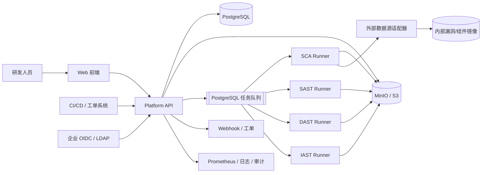

# DevSecurity 架构

## 1. 目标与约束

DevSecurity 是内网部署的安全 SDLC 控制面，统一编排 SCA、SAST、DAST、IAST，并把标准化结果提供给研发人员和已有 DevOps 系统。设计基线为几百名用户、多个项目、持续集成任务和安全团队共同使用。

关键约束：

- 代码、扫描证据和凭据不离开客户可控网络。
- 扫描是异步长任务，平台必须能承受引擎超时、崩溃和结果格式变化。
- 扫描器属于不可信执行组件；它们读取恶意代码或访问测试系统时不能获得平台管理凭据。
- 外部 DevOps 只通过带版本、可审计的 API 集成，不依赖平台前端。
- 初期尽量减少基础设施组件数量。

## 2. 系统上下文



## 3. 组件划分

### 控制面

**Platform Backend**

- 身份、项目、授权、扫描任务、任务配额和状态机。
- 扫描结果标准化、去重、状态流转、策略和审计。
- 提供 OpenAPI、CI 集成、Webhook 和导出。
- 不直接执行用户代码或攻击被扫描目标。

**Platform Frontend**

- 项目总览、扫描配置、任务进度、风险清单、详情、趋势、策略和系统管理。
- 只依赖后端公开 API，不保存扫描器密钥。

### 执行面

四个 Runner 都以独立容器/进程运行，通过适配器与控制面通信：

- **SCA Runner**：由 `sca-server` 控制服务和独立 `sca` CLI 组成；控制服务只处理任务、进程和状态，CLI 负责解析清单、生成依赖图和 SBOM、匹配内部漏洞数据。
- **SAST Runner**：调度开源静态分析引擎，统一规则和结果。
- **DAST Runner**：经授权对登记的目标执行黑盒扫描。
- **IAST Runner**：管理测试环境中的 Agent 和测试流量的灰盒检测。

Runner 只获得当前任务所需的最小数据集，默认可在无外部网络环境中运行；需要漏洞库或目标访问时必须经过网络策略放行。Core 与同机 SCA Runner 通过按 `scan_id` 隔离的临时工作卷交接源码和大型镜像，控制 HTTP 不承载文件内容。

### 数据面

- **PostgreSQL**：用户映射、项目、扫描任务、结论、策略、审计、outbox 和任务租约。
- **MinIO / S3 兼容对象存储**：上传归档、SBOM、原始报告、脱敏日志和导出文件。
- **内部漏洞/组件镜像**：经过校验、签名和版本化的 SCA 数据源。
- **扫描临时工作卷**：Core 与同机 Runner 共享的高敏临时数据卷，用于 GB 级源码、镜像和报告，任务结束后强制清理。
- **Prometheus/Grafana**：平台、Runner、队列和数据更新指标。

首个版本不强制引入独立消息队列。扫描量在数百人规模内时，可用 PostgreSQL 的 `FOR UPDATE SKIP LOCKED` 实现任务租约；当吞吐或扇出需要时再引入 NATS/Kafka，而不改变业务状态机。

## 4. 技术选型

| 层 | 选择 | 理由 |
|---|---|---|
| 平台后端 | Java 17 + Spring Boot 3.3 + Spring Cloud 2023 | 网关、服务发现、Spring Security、数据访问生态成熟，便于按领域拆分服务 |
| SCA 引擎 | Go 1.23；独立 `sca` CLI + `sca-server` 控制服务 | CLI 可单独使用并直接处理本地大文件；控制服务负责 HTTP/RPC 任务、进程和状态边界 |
| Web 前端 | React + TypeScript + Vite | 通用人才市场、组件生态成熟、长期维护成本低 |
| 前端数据/路由 | TanStack Query + TanStack Router | 扫描任务轮询、缓存和复杂路由表达清晰 |
| UI 组件 | Ant Design | 企业后台表格、表单、权限和国际化能力较完整 |
| 图表 | ECharts | 风险趋势和统计图表能力成熟 |
| 数据库 | PostgreSQL 16+ | 事务、JSONB、全文检索和 `SKIP LOCKED` 足够支撑首版 |
| 对象存储 | MinIO，生产可替换为 S3 兼容服务 | 内网可控，适合保存报告与归档 |
| 部署 | OCI 容器；首版 Compose，规模增长后 K8s | 保留部署弹性，同时降低初始运维门槛 |

前端不使用扫描器 SDK，不直接访问 MinIO；所有下载通过后端授权和短时签名 URL。后端、扫描器、数据源适配器均通过接口隔离。

## 5. 核心流程

1. 用户使用本地账号/JWT 或后续 OIDC 身份创建扫描请求，资源访问始终经过项目级授权。
2. 后端验证项目权限、目标授权、配额和参数，创建 `Scan`。
3. 对于源码扫描，后端生成短时上传凭证或从受控 Git 适配器拉取指定 commit；只处理固定 revision，并原子发布到按 `scan_id` 隔离的共享临时工作卷。
4. Worker 通过数据库租约获得任务，向 Runner 控制服务提交只含元数据的请求；Runner 根据固定根目录定位输入，不接收 HTTP 文件体。
5. Runner 调用独立 CLI 引擎，将结果转换成统一 `Finding`，原报告写入对象存储。
6. Runner 分批提交相对路径、规则 ID、严重性、置信度和证据；提交必须幂等。
7. 后端执行去重、策略计算和状态流转，触发 Webhook/门禁结果。
8. 清理临时源码和凭据；保留对象按 Q-009 的策略过期。

任务状态：

`queued -> provisioning -> running -> finalizing -> succeeded | partially_succeeded | failed | canceled | expired`

只有明确失败才进入 `failed`；部分引擎不可用时进入 `partially_succeeded`，避免把扫描器故障伪装成“无漏洞”。

## 6. 统一扫描器契约

每个引擎适配器至少提供：

- 输入规格：版本、支持的扫描类型、需要的产物和目标参数。
- 启动/取消/健康检查。
- 状态与进度事件，所有时间使用 UTC。
- `Finding`、`SBOM`、`Artifact` 三类输出的版本化 schema。
- 原始日志和报告的位置、校验和、大小限制。
- 错误分类：输入错误、授权错误、引擎错误、目标不可达、超时、资源不足。

完整契约见 [docs/design-docs/engine-adapter-contract.md](docs/design-docs/engine-adapter-contract.md)。

## 7. API 边界

面向 CI 的主要接口：

```text
POST   /api/v1/projects/{project_id}/scans
GET    /api/v1/scans/{scan_id}
GET    /api/v1/scans/{scan_id}/findings?cursor=...
GET    /api/v1/scans/{scan_id}/report.sarif
POST   /api/v1/scans/{scan_id}/cancel
POST   /api/v1/webhooks/subscriptions
```

对创建请求支持 `Idempotency-Key`；对可变资源和分页使用稳定 ID/cursor。外部系统可轮询，也可订阅签名 Webhook。认证、错误模型和兼容性约定见 [platform/backend/SPEC.md](platform/backend/SPEC.md)。

## 8. 数据模型概览

核心实体：

- `Organization`、`User`、`RoleBinding`
- `Project`、`Repository`、`ScanTarget`
- `ScanProfile`、`Scan`、`ScanStep`、`ScanArtifact`
- `Finding`、`FindingOccurrence`、`FindingEvent`、`Suppression`
- `Policy`、`PolicyDecision`、`WebhookSubscription`
- `AuditEvent`、`OutboxEvent`、`QuotaUsage`

所有租户级数据带 `tenant_id`；所有状态变更写审计。扫描器不能直接修改业务状态表，只能通过 Runner 的受限 API 提交结果。

概念 schema 见 [docs/generated/db-schema.md](docs/generated/db-schema.md)。该文件是设计辅助，不是最终迁移脚本。

## 9. 隔离与安全边界

- API、数据库、对象存储和内部漏洞镜像只在受控内部网络可达。
- Runner 使用独立服务身份、最小对象存储前缀和短时任务令牌。
- Core 与 Runner 共享的临时工作卷只允许受控容器访问；请求不得提供任意主机路径，Runner 必须校验规范化路径和符号链接边界。
- SCA 控制 HTTP 只承载小型任务元数据和状态，源码、GB 级镜像和大型报告通过工作卷按引用传递。
- 源码扫描容器默认无特权、只读根文件系统、CPU/内存/磁盘/时间限制、默认拒绝外联。
- 需要构建的扫描在一次性容器中执行，禁止挂载 Docker socket 和宿主机凭据。
- DAST 网络出口通过专用代理与目标白名单，阻断云元数据、管理网段和未登记域名。
- IAST Agent 与结果上传使用独立签名和短期授权，测试结束后强制回收。
- 平台不记录源码全文到应用日志；错误日志做字段级脱敏，原始证据按对象存储权限访问。

## 10. 可用性与容量假设

初始规划值，待 Q-011 确认：

- 300 名注册用户，80 个并发 UI 用户；
- 每天 1,000 次扫描请求，20 个并发扫描任务；
- 单源码仓库建议不超过 2 GB、500 万行，超过后拆分或提高专项配额；
- API 可用性目标 99.9%/月，扫描任务不承诺固定完成时限；
- 外部漏洞库同步失败时继续使用最后一版已签名快照，并显式告警数据陈旧。

容量数字用于指导设计，不构成已签署 SLA。

## 11. 演进路径

1. **立项验证**：确认问题清单，建立固定基准项目和工具许可证清单。
2. **平台内核**：认证、项目、任务、结果、RBAC、审计、对象存储。
3. **SCA/SAST MVP**：优先覆盖公司主语言，SARIF/JSON 和 CI 闭环。
4. **DAST 受控扫描**：目标登记、授权、ZAP 适配、证据管理。
5. **IAST 试点**：单一运行时、测试环境、受控流量。
6. **门禁与治理**：策略、例外、趋势、工单和通知。

架构层面的最终决策需要在 [docs/design-docs/index.md](docs/design-docs/index.md) 下留痕。
