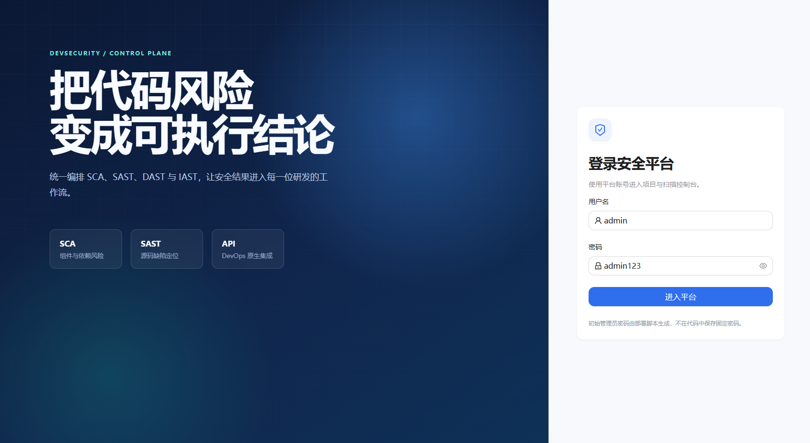
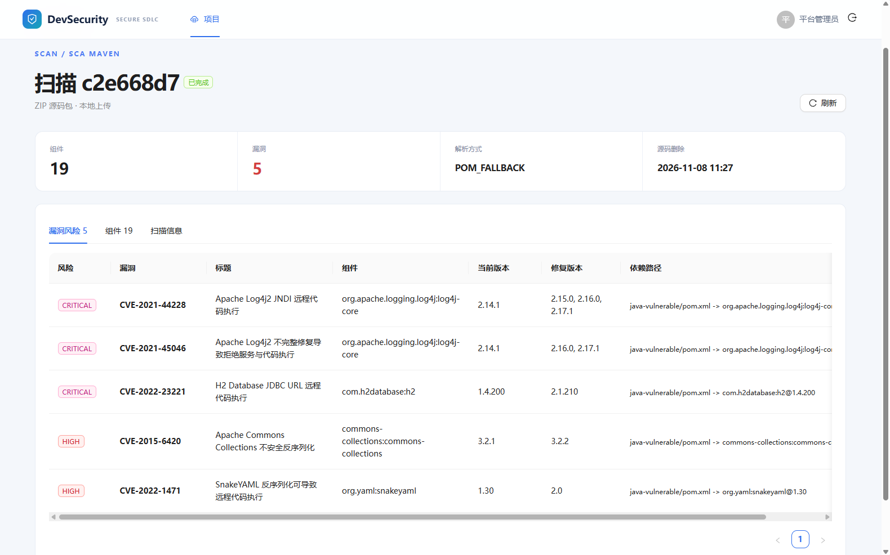
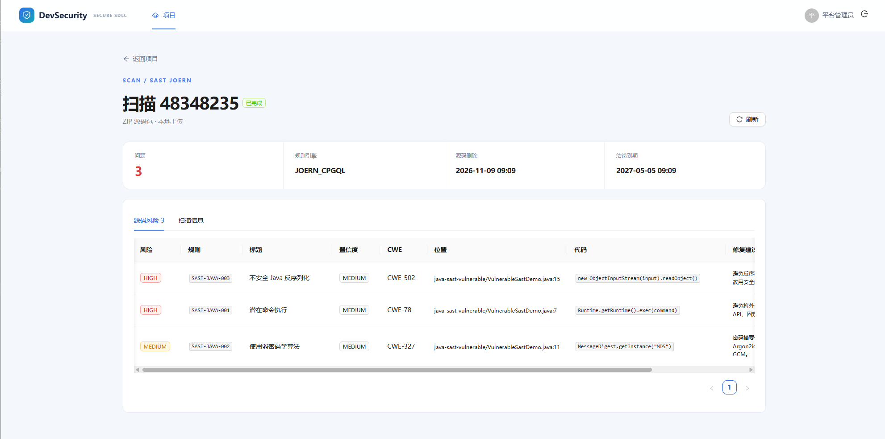

# 效果展示

## 登录页面

## SCA检测效果

## SAST检测效果

扫描创建时可选择 `SAST · Joern`，上传包含 `.java` 文件的 ZIP。结果页展示：

- 规则 ID、风险级别和置信度；
- CWE 分类；
- 源码文件、起始行号和代码片段；
- 修复建议。

可使用 `examples/java-sast-vulnerable/` 演示命令执行、弱加密和不安全反序列化风险；`examples/java-sast-safe/` 用于验证安全样例返回 0 条规则命中。

